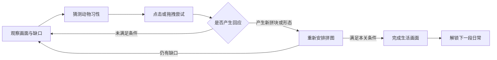

# PuzzleGame 游戏玩法策划：暖日小院

> **一句话定位：**一款暖色、低饱和度的动物拼图轻解谜游戏。玩家观察动物与环境，触发小小的生活事件，找回或改变拼块，最后拼成一幅完整的日常。
>
> **核心承诺：缺少的那一块，藏在你和小动物的互动里。**

## 1. 文档状态与阅读入口

- 文档状态.status：`draft`。这是供讨论与原型验证的玩法初稿，不表示功能已经开发或运行验证完成。
- 暂定名称：《暖日小院》，仅为本方案的情绪与场景锚点，可以更换。
- 本轮范围：玩法策划及配套需求、交互说明。不修改游戏逻辑，不生成页面图片。
- 默认操作：先以当前 Unity 项目的鼠标点击、拖拽验证；触屏采用同样的点按、拖拽语义。首发平台尚未确定。
- 配套文档：[[PuzzleGame/玩法策划/暖日小院/prd|产品需求与验收]]、[[PuzzleGame/玩法策划/暖日小院/interaction|交互逻辑与状态]]。
- 扩展灵感：[[PuzzleGame/玩法策划/暖日小院/关卡灵感集|12个关卡创意与组合示例]]。灵感属于概念储备，不自动加入首版开发范围。
- 项目背景：已读取 [[PuzzleGame/Scheme/开发计划|开发计划]] 与 [[PuzzleGame/Scheme/修改记录|修改记录]]，并在 2026-10-31 核对相关源码。旧计划不直接代表当前代码状态。

## 2. 想让玩家感受到什么

玩家不是在把动物塞进盒子，而是在为小动物安排一个舒服的午后。拼图盘可以表现为野餐垫、窗边坐垫、花园相册或一张等待完成的生活画。

画面中央仍然是熟悉的拼图格，四周则是有意义的生活空间：轻轻摇动的草丛、露出线头的篮子、暖暖的窗台，以及爱追飞盘的小狗。

玩家起初会觉得“怎么总差一格”，随后发现“小狗一直看着草丛”。把小狗拖过去，它兴奋地探头，叼回一只飞盘。缺口有了来源，空间谜题也有了情感上的答案。

### 目标用户与三个卖点

- 目标用户：喜欢可爱动物、轻松整理、观察细节与短篇谜题的玩家；希望思考，但不希望被倒计时和失败惩罚催促。
- 卖点一：拼块既是几何形状，也是有习性的角色；理解角色可以改变解题条件。
- 卖点二：拼图盘外的场景参与解谜，同一画面形成“观察、互动、拼合”的完整体验。
- 卖点三：每关完成一件温柔的小事，奖励是一段回应、一幅完整画面和一次“原来如此”。

本方案只讨论体验方向，没有开展竞品调研，不将品类差异写成已验证的市场结论。

## 3. 用 MDA 约束设计

| 层次 | 本作的设计选择 | 必须避免的偏离 |
| --- | --- | --- |
| 机制 Mechanics | 拖拽、90°旋转、环境互动、有限形态变化、可撤销操作 | 精确卡时间、无提示的点击次数、随机掉落关键拼块 |
| 动态 Dynamics | 观察线索，提出猜想，尝试动物行为，改变拼块集合，再安排空间 | 把每件物品拖遍全屏、反复乱点、等待隐藏计时器 |
| 体验 Aesthetics | 好奇、被回应的温暖、理解规则的满足、拼完整的舒展感 | 焦虑、动物受苦、误操作损失、付费才能继续 |

用自主选择满足探索，用明确因果建立掌握感，用动物回应建立陪伴感。以上为设计依据，实际感受需要试玩验证。

## 4. 核心循环与一关的节奏



| 环节 | 玩家问题 | 游戏回应 | 对应界面 |
| --- | --- | --- | --- |
| 回流 | 今天去哪里看看？ | 已通关状态和下一关主题 | `level-select` 选关 |
| 准备 | 这幅画里有什么？ | 关名、拼图盘、托盘、少量环境线索 | `puzzle-play` 关卡 |
| 探索 | 哪只动物能帮上忙？ | 注视、耳朵、气泡、环境轻动 | `puzzle-play` 关卡 |
| 拼合 | 新形态和新物件怎么安排？ | 覆盖预览、合法吸附、柔和拒绝反馈 | `puzzle-play` 关卡 |
| 完成与成长 | 刚才发生了什么温柔小事？ | 一小段庆祝和完整画面，记录通关 | `level-complete` 同页结算 |
| 商业补给 | 本轮没有此环节 | 原型不引入商店、体力或付费提示 | 不新增页面 |

建议原型节奏：前两关各 1—3 分钟，后续常规关 3—8 分钟。它们是设计目标，不是实测时长；玩家可以无限停留。

## 5. 玩法基础规则

### 5.1 三种空间

| 空间 | 作用 | 规则 |
| --- | --- | --- |
| 拼图盘 | 完成空间排布 | 拼块覆盖整数格；不得越界、重叠或覆盖禁止放置格；只允许90°旋转，不允许镜像 |
| 动物托盘 | 暂存、观察、变形 | 能容纳全部本关拼块；预留一只最大形态动物的操作空间；可旋转，不存在掉出屏幕丢失 |
| 环境互动区 | 触发生活事件 | 使用有线索的区域，不用像素级热点；与拼图盘、工具栏分开，避免一次释放命中两种规则 |

画面看起来柔和，功能轮廓仍需清楚。拼图格、托盘、环境的边界不能仅靠颜色区别。

### 5.2 拼块的三种身份

1. **初始拼块：**开局可用的动物、垫子和生活物件。
2. **互动奖励拼块：**确定触发后获得的实体，如飞盘。进入托盘后按普通拼块规则放置。
3. **形态拼块：**同一只动物具有不同占格形状，如短猫与长猫。变形替换形态，不复制动物。

每关明确列出必须使用的拼块。原型三关要求所有初始块和必经奖励块最终入盘；用于互动的小狗也必须回来，不能被当作“消耗材料”。可选彩蛋不产生额外的必放拼块。

### 5.3 通关条件

同时满足以下条件才通关：

- 所有目标可放置格恰好被合法覆盖。
- 本关要求的拼块全部入盘，且形态满足配置要求。
- 本关必经互动已经完成；不要求可选彩蛋。
- 没有拖拽、变形或奖励生成事务尚未结束。

关卡可接受多个合法排布，不强迫玩家复现唯一美术摆法。装饰演出应适配实际排布，或在结算中展示独立的生活插画。

### 5.4 “必经谜题”和“彩蛋”分开设计

| 类型 | 是否影响通关 | 线索要求 | 奖励 |
| --- | --- | --- | --- |
| 必经发现 | 是 | 开局可见线索；互动前可获得确认；提供三级提示 | 补充面积、改变形状或解锁明确条件 |
| 可选彩蛋 | 否 | 可以更隐蔽，但遵守动物与场景逻辑 | 表情、声音、短动画；后续可记入图鉴 |

用户提出的小狗取飞盘、猫咪变长，在需要补足格子的关卡中属于“必经发现”。它们可以有彩蛋般的惊喜，但不能缺少谜题应有的线索。

## 6. 招牌机制一：小狗去草丛找飞盘

### 玩家看到的故事

草丛露出一小段珊瑚色圆边，旁边有浅浅的爪印。小狗偶尔抬头望向那里，摇一下尾巴。玩家拖起小狗并靠近草丛时，草叶分开，圆边更明显，小狗出现飞盘气泡。

### 完整规则

| 项目 | 设计 |
| --- | --- |
| 前提 | 本关有取物规则；草丛入口已开放；这只飞盘本局尚未领取 |
| 输入 | 将小狗拖到草丛有效区后释放；不要求停留、甩动或速度 |
| 过程 | 立即确认命中并锁定该次交互，播放约0.8—1.2秒探草、叼回演出 |
| 结果 | 同一只狗回到托盘；新增一只1×1飞盘进入托盘，飞盘形状与占格一致 |
| 状态 | 将规则记录为已完成；飞盘具有稳定身份，不能再次生成 |
| 再次尝试 | 小狗轻嗅草丛，气泡显示“已经找到啦”；不发第二只飞盘 |
| 错误动物或未解锁 | 给出具体反馈，物件回到拖拽前合法位置；不扣次数 |
| 动画打断 | 本局状态以完整事务为单位提交或回滚，不允许只标记领取却没有飞盘 |

小狗原有面积不变。飞盘增加的是可用拼图面积，而不是替代小狗。一级提示“它一直在看哪里？”，二级提示圈出草丛和小狗，三级提示直接演示拖拽方向并写明释放位置。

## 7. 招牌机制二：慵懒短猫变成眩晕长猫

保留用户提出的“多次旋转、短暂眩晕、变成长条”的惊喜。表现为小猫跟着转圈，头顶绕过一小颗星星，随后伸一个长长的懒腰；不用疼痛、呕吐或持续不适表达。

### 解决与普通旋转的冲突

- 初始形态占1×2格，长形占1×3格。
- **只在托盘中的短猫累计有效点击。**每次完成一次90°旋转计1次，达到4次触发一次变形。
- 不设置连续点击的时间窗口。慢慢点、暂停、先摆其他块都不会清零；这里的“多次”不等于手速挑战。
- 拼图盘内点击只执行原有的合法旋转判定，不积累变形次数；非法旋转也不计数。
- 拖拽、变形演出中忽略旋转点击，避免一次点击被多个监听重复处理。
- 解锁长形后不再累计转圈次数；之后在托盘中使用明确的“蜷起／伸展”控件切换已解锁形态。短、长两种形态各自仍可正常旋转。
- 关卡结束前不会因等待自动缩回。需要1×3形态的关卡不能通过等候丢失解题成果。

### 线索与每次反馈

初始有一幅小猫绕着毛线圈转身、最后伸懒腰的纸片涂鸦。每次有效点击给出略有变化的表情，以及托盘旁逐步补齐的四段小环；首次可用文字“它好像还想再转一下”。第4次伸展后，小环变为短猫、长猫两个形态图标。

四段进度只作为可读反馈，不要求玩家猜精确次数。提示三级可直接说明“把短猫放回托盘，慢慢点四次”。

### 数据与防卡死约束

- 保留同一个动物身份，将占格集合由短形替换为长形；不同时保留两只猫。
- 只在无网格绑定的托盘中切换形态，避免新增格与已摆拼块相撞。
- 拼图盘里的猫需要先拖回托盘，再切换；托盘不足不能成为失败条件。
- 撤销第4次旋转时，同时恢复猫形态、次数和朝向。撤销后可以再次解锁，但不能额外增加实体或奖励。

## 8. 可复用的互动语法

每条主线谜题均包含：**能注意到的线索、能解释的猜想、简单的动作、及时的反馈、改变解题条件的结果、清楚的恢复方式。**

首版仅做取物与变形两类。以下是扩展储备，不代表全部进入开发：

| 创意 | 可观察线索 | 行动与反馈 | 拼图变化 | 公平性与恢复 | 优先级 |
| --- | --- | --- | --- | --- | --- |
| 小狗寻飞盘 | 圆边、爪印、小狗注视草丛 | 狗拖进草丛，叼回飞盘 | 新增1×1飞盘，狗保留 | 每关一次，可撤销，无随机掉落 | P0 |
| 猫咪伸懒腰 | 转圈涂鸦、逐次出现的小环 | 托盘点4次，短暂星星后伸展 | 同一只猫1×2变1×3 | 无时限，可切回，不在盘内突变 | P0 |
| 兔子找胡萝卜 | 菜地露出叶子，兔子闻一闻 | 兔子拖向菜地，轻轻拔萝卜 | 新增2格萝卜块 | 菜地范围宽，产物固定，兔子返回 | P1 |
| 刺猬摊开野餐毯 | 毯子露出折角，刺猬背着同纹样 | 将刺猬放到毯边，抖落并铺开 | 产生预设L形毯块 | 刺猬不丢失；未命中折角给方向反馈 | P1 |
| 小鸟整理树枝 | 篮子散出两种长度的树枝 | 小鸟拖向篮子，选出一根 | 新增3格直条枝块 | 没有随机尺寸；演出前预示长度 | P2 |
| 乌龟晒太阳 | 窗边暖斑、乌龟探头 | 拖到暖斑后主动舒展 | 固定形态切换，面积是否变化由关卡预先标注 | 不要求等待真实时间；可在托盘恢复 | P2 |

可选彩蛋示例：把已经取过飞盘的小狗带到水碗边，它喝一口水；长猫闲置休息时，自主打一个轻轻的呼噜。二者只给回应，不改变通关面积，不形成必须乱试的隐藏清单。长猫的点击始终执行旋转，呼噜不另占一个点击手势。

同一种动物与同类物件的关系应保持稳定。新章节可以增加条件，但必须先展示条件，不能在外观完全相同的草丛上悄悄换规则。

## 9. 关卡设计方法与首批样关

### 9.1 先做面积账，再做故事线索

设目标可放置格数为 `B`，初始拼块面积总和为 `A0`，奖励新增面积为 `R`，形态变化面积差为 `ΔS`。原型采用：

```text
A0 < B
A0 + R + ΔS = B
```

面积相等只是必要条件。每关还必须提供合法覆盖示例，核对形状连通、旋转、边界与依赖顺序。不能把“差一格”当成关卡天然有解的证据。

原型三个小棋盘均无障碍格；下列图案表示设计层面的排布示例，不是Unity配置文件，也不声称解法唯一。

#### 第01关：草丛里的飞盘

**教学目标：**发现拼图盘外的动物互动可以找回缺失拼块。棋盘3列×3行，9个目标格。

| 字母 | 拼块 | 初始形状与面积 | 终局要求 |
| --- | --- | --- | --- |
| D | 小狗 | 直2格 | 保留原形，必须入盘 |
| R | 叶簇 | L形3格 | 普通拼块，无互动 |
| T | 折叠软垫 | L形3格 | 普通拼块，无互动 |
| F | 飞盘 | 初始不存在，奖励1格 | 取回后必须入盘 |

初始面积`2+3+3=8`，小狗找回飞盘后`8+1=9`。草丛的圆边、爪印和小狗视线构成线索；将狗拖进草丛后，狗与飞盘一起回托盘。一个终局示例：

```text
D D F
R T T
R R T
```

两个L形块可通过90°旋转放入，不需要镜像。预期惊喜是“原来画框外也能找拼图”，而不是辨认复杂形状。

#### 第02关：伸一个长懒腰

**教学目标：**同一只动物能改变占格形状。棋盘3列×4行，12个目标格；本关没有草丛取物目标。

| 字母 | 拼块 | 初始形状与面积 | 终局要求 |
| --- | --- | --- | --- |
| C | 小猫 | 直2格 | 托盘4次有效旋转后变直3格 |
| R | 叶簇 | 直3格 | 普通拼块，无互动 |
| T | 方形软垫 | 2×2，共4格 | 普通拼块，无互动 |
| W | 木垫 | 直2格 | 普通拼块，无互动 |

初始面积`2+3+4+2=11`，猫伸展后`11+1=12`。猫旁的涂鸦与托盘三格长的浅印提示“它还能伸展”；四段进度解释点击过程。一个终局示例：

```text
C C C
R T T
R T T
R W W
```

只有猫进入长形才能补足面积。图中的三格浅印是托盘提示，不是限制棋盘必须照着摆放的指定答案。

#### 第03关：野餐布的小秘密

**教学目标：**在一个温柔的小故事中组合已经学过的规则。棋盘4列×4行，16个目标格。

| 字母 | 拼块 | 初始形状与面积 | 终局要求 |
| --- | --- | --- | --- |
| C | 小猫 | 直2格 | 变为直3格 |
| D | 小狗 | 直2格 | 取飞盘后保留原形 |
| T | 方形软垫 | 2×2，共4格 | 普通拼块 |
| R | 叶簇 | L形3格 | 普通拼块 |
| B | 长坐垫 | 直3格 | 普通拼块 |
| F | 飞盘 | 初始不存在，奖励1格 | 取回后必须入盘 |

初始面积`2+2+4+3+3=14`。猫伸展增加1格，飞盘增加1格，最终`14+1+1=16`。一个终局示例：

```text
C C C F
D D T T
R R T T
R B B B
```

开场小猫趴在盘外野餐布边缘；它属于本关拼块，仍可拖拽。猫压住通向草丛的布角，旁边露出一点爪印。将猫移开到托盘或合法棋盘位置，布角自动舒展，草丛入口与飞盘反光显露，并设置“入口已开放”。把猫放回附近不会重新关闭入口。

此后两件事可以自由排序：把猫放进托盘完成四次旋转；把狗送进草丛取回飞盘。依赖只有“移开猫，开放入口，狗取飞盘”，猫变长不依赖飞盘，因此没有循环条件。狗过早接近时会望向被压住的布角，明确反馈“入口被挡住了”，不会无声失败。

移开猫复用普通拖拽，不引入第三种手势、等待要求或消耗道具。地面不会因为猫在托盘中旋转而自动变化；开放入口由明确的移开事件触发。

#### 三关的验证口径

以上字母图为各块提供一个连通、无重叠、无空格的覆盖示例。相同字母在不同关卡代表本关表中指定形状，叶簇和软垫可以有不同配置，不能复用错配置。面积账说明初始拼块无法单独通关；示例说明最终形状集合至少有一个解。不声称唯一解或试玩难度已经验证。

### 9.2 后续章节的渐进安排

| 关卡 | 主题与新信息 | 探索负担 | 拼图负担 | 阶段 |
| --- | --- | --- | --- | --- |
| 01 | 草丛里的飞盘：学习盘外取物 | 一只动物、一个显著热点 | 3×3、无障碍 | P0实作样关 |
| 02 | 伸一个长懒腰：学习托盘形态变化 | 一只猫、可见进度 | 3×4、无障碍 | P0实作样关 |
| 03 | 午后野餐：组合狗与猫的已知规则 | 一个清楚的先后条件 | 4×4、无障碍 | P0实作样关 |
| 04 | 新草丛，老朋友：迁移取物规律 | 换布景，不换规则 | 4×4、增加L形块 | 后续设计储备 |
| 05 | 哪个形态更合适：先观察缺口再选猫形态 | 可逆形态选择 | 目标缺口偏长 | 后续设计储备 |
| 06 | 菜地来客：引入兔子与胡萝卜 | 只新增一种动物习性 | 几何难度回落 | P1候选 |
| 07 | 窗边一角：复用已学互动 | 不加新规则 | 一个可见禁止放置区 | P1候选 |
| 08 | 一起晒太阳：小章收束 | 至多两步依赖 | 5×4上限候选 | P1候选 |

一次只提高一个维度：新习性、依赖步数、几何复杂度或场景信息量。后三者不要在引入新动物时同时上升。第04—08关尚未给出完整拼块配置，不能列为已验证可解。

## 10. 线索、提示与失败体验

### 10.1 线索必须构成因果

- 第一层：画面线索，如飞盘圆边、爪印、猫咪涂鸦。
- 第二层：角色意向，如注视、耳朵朝向、轻轻的呼吸或气泡。
- 第三层：操作确认，拖近正确区域时产生轮廓、局部动作或预期结果图标。

主线互动区建议每屏不超过2个；这个数值是原型限制，可通过试玩调整。关键提示同时使用形状、动作或文字，不依赖单一色相，也不只存在于声音中。

### 10.2 三级提示

| 层级 | 作用 | 飞盘关示例 |
| --- | --- | --- |
| 1 提醒观察 | 提示方向，不给动作答案 | “小狗好像在找什么。” |
| 2 明确关联 | 指出相关角色与区域 | 同时标记小狗和露出圆边的草丛 |
| 3 给出动作 | 帮助玩家继续，不再猜规则 | “把小狗拖到这片草丛，松开试试。” |

提示免费、无限查看、由玩家主动逐级展开，不影响通关评价。可在长时间无有效进展后轻轻呼吸一次提示按钮，但不能自动替玩家揭谜或反复弹窗。具体提醒时间留到试玩调优，首版不做强制计时提醒。

### 10.3 无惩罚试探与恢复

- 非法放置恢复到拖拽前合法位置，给一次轻柔边缘提示；不扣血、扣分或扣行动力。
- 操作历史记录最近20个有效步骤。拖拽、旋转、互动与形态变化均可撤销，空点和非法操作不占历史。
- 取物作为一个整体步骤记录，包含狗的位置、规则完成标记和飞盘生成；按时间倒序撤销，不会留下孤立奖励。
- P0同时只执行一个改变局面的事务。取物、变形的提交或回滚结束前，暂时阻断其他拼块的拖拽、旋转、撤销和重开；提示与设置仍可查看。装饰性尾声可以在完整提交后继续，不继续阻断输入。
- 历史超过20步后仍可随时重开；界面清楚显示是否可撤销，不声称无限撤销。
- 重开恢复本关初始拼块、环境、次数与奖励状态；不删除以前已保存的通关记录。
- P0只承诺通关进度持久化。中途离开关卡会重新开始，离开前明确提示；断线不影响离线玩法。中途局面续玩列为P1。

## 11. 风格、反馈与故事表达

### 视觉方向

奶油白、燕麦米、浅杏、灰豆绿、陶土粉作为候选色。通过色块边界、明度和轮廓保证辨识，不因低饱和度牺牲格子可读性。动物外形圆润，保留占格形状，不能让可爱插画遮住实际覆盖范围。

关键物件可以比背景略清晰，但不使用整屏霓虹高光。草丛的热点轮廓只在合适时出现，避免所有装饰持续闪烁。

### 反馈方向

- 点击、拖拽命中与合法性反馈以输入后100毫秒内开始为原型目标；与完整演出时长分开验收。
- 取物、伸展演出宜短，重复演出允许简化。减少动效时使用静态前后形态和简短文字替代，状态结果保持一致。
- 音效使用纸张、草叶、木质与轻柔动物声；关闭声音后依然可理解谜题。
- 结算约2—3秒即可表达温暖，提供跳过；不播放长时间、无法打断的奖励瀑布。
- 文案表达陪伴：“草丛里有个老朋友。”“它把自己伸得长长的。”“今天的午后，刚刚好。”

### 最小世界观

一群小动物住在同一座小院。每关是它们的一段日常：找回玩具、午后打盹、准备野餐、窗边晒太阳。玩家通过互动理解它们，再将日常拼完整。不先铺设复杂主线、阵营和大段剧情。

## 12. 系统清单、成长与经济

| 系统 | 设计级别 | 迭代优先级 | 作用 |
| --- | --- | --- | --- |
| 网格放置、旋转与预览 | must-have | P0 | 保留空间拼图核心 |
| 动物与环境交互规则 | genre-specific | P0 | 实现小狗取飞盘 |
| 动物有限形态状态 | genre-specific | P0 | 实现短猫、长猫 |
| 撤销、重开、三级提示 | must-have | P0 | 保障轻松探索与恢复 |
| 目标、通关与存档 | must-have | P0 | 让谜题与几何条件共同收尾 |
| 发现图鉴、生活相册 | optional | P1 | 记录已理解的习性与完整画面 |
| 中途局面续玩 | optional | P1 | 长关卡中的便利性 |
| 小院装修 | optional | P2 | 仅在核心玩法成立后评估 |

成长采用关卡解锁与“我更了解这只动物了”的知识积累。P1图鉴记录习性，不给数值战力；重玩可以欣赏互动，不靠重复刷奖励推进。

P0没有软通货、硬通货、体力、每日签到、随机关键掉落、付费提示和服务端经济。关键拼块由确定规则产生。商业化尚未确定；以后可评估一次性购买或章节内容，不能先假定已有支付与校验系统。首版不做星级、手速榜或提示惩罚。

## 13. 与现有Unity项目如何衔接

以下为2026-10-31的静态源码核对与拟议扩展，不代表运行验证。

源码根目录：`D:/GameDevelop/Package/Unity/PuzzleGame/`。

| 当前入口 | 已核对的当前行为 | 本方案需要的扩展 |
| --- | --- | --- |
| `Packages/cn.etetet.gameplay/Scripts/HotfixView/Client/LevelSessionComponentSystem.cs` | 已有进入、返回、重开、会话版本与加载/完成门禁 | 将互动事务、撤销与完成表现纳入同一关卡生命周期，不另外造一套入口 |
| `Packages/cn.etetet.gameplay/Scripts/HotfixView/Client/Event/Game/Grid/DragPuzzleEnd_CheckSlot.cs` | 尝试入盘，失败后调用回原位 | 在入盘与回弹分支之间解析明确的盘外互动目标，并定义成功、拒绝与无目标三种结果 |
| `Packages/cn.etetet.gameplay/Scripts/HotfixView/Client/Event/Game/Puzzle/PuzzleBase/DragPuzzle/Click_PuzzleClick.cs` | 未放置拼块直接旋转；已放置拼块进行合法旋转检查 | 区分托盘旋转与盘内旋转；短猫只累计前者；新形态通过单独事件刷新数据与视图 |
| `Packages/cn.etetet.gameplay/Scripts/Model/Client/Puzzle/Puzzle.cs` 与 `Scripts/Hotfix/Client/PuzzleSystem.cs` | 拼块保存配置、旋转、格偏移和绑定，初始化依据配置创建格 | 新增稳定拼块身份与运行时形态状态；不能只拉长贴图而不更新占格、碰撞与视图 |
| `Packages/cn.etetet.gameplay/Scripts/Hotfix/Client/GridSystem.cs` | `CheckGameOver`检查可放置格是否有拼块 | 扩展为目标格覆盖、必放拼块、必经发现与事务完成的联合判定 |
| `Packages/cn.etetet.gameplay/Scripts/HotfixView/Client/Event/Game/Grid/SlotSetPuzzle_CheckOver.cs` | 已有完成门禁、通关防重复记录、保存结果检查及返回选关 | 复用现有门禁；加入可留在本关的结算状态及保存失败反馈，不能把已有处理写成完全缺失 |

上表中同一行的 `Scripts/...` 缩写均位于 `Packages/cn.etetet.gameplay/` 中。落地时遵守ET四层：Model表达数据，Hotfix处理规则，HotfixView处理命中输入、动画与UI；Hotfix不直接获取View。

建议用配置描述 `interactionId`、目标动物标签、目标区域、前置条件、一次性标记、结果拼块或结果形态及三级提示。具体类名、字段与Luban表结构待实现任务确定，不直接修改生成类充当配置源。

## 14. 首版原型范围与验证计划

### 最小切片

只做同一小院场景、狗和猫两种可互动动物、若干无互动的生活拼块、两类规则、三个可解关卡、免费提示、有限撤销、重开与通关保存。用现有占格可读的占位素材也能先验证规则；正式美术、完整图鉴和装修不作为第一轮前置。

推进顺序建议：

1. 先验证第01关：玩家能否从注视与圆边推理“小狗去草丛”。
2. 再验证第02关：托盘连续操作是否清楚，玩家会不会误以为盘内旋转也应变形。
3. 最后验证第03关：两机制组合是否仍有清楚的因果关系和合法排布。
4. 通过后再扩展章节与动物，不先批量生产内容。

### 试玩观察与暂定目标

建议找5位未看过方案的玩家试玩。记录他们看到什么、为什么尝试该动作、哪里开始乱拖，以及是否理解形态变化。下列数字是发现问题用的原型门槛，不是统计结论：

- 至少4/5玩家能在第01关90秒内完成正确互动，最多使用一级提示。
- 至少4/5玩家能在第02关后说清“托盘点击会积累，盘内只旋转”。
- 三关均不存在奖励重复、动物丢失或必须退出应用才能恢复的情况。
- 出现20秒以上无目标乱拖时，回看线索与反馈设计，不先归因于玩家不够聪明。
- 收集1—5分的轻松感与因果清晰度评价，并追问具体原因；小样本只用于方向判断。

不靠强制倒计时达成这些目标。测试计时对玩家不可见，不构成玩法惩罚。

### 本次交付的验证边界

- 已核对：相关源码入口、主线规则的一致性、配套需求与交互文档。
- 样关的离散占格与面积校验结果见第9节及配套验收记录；不能据此宣称Unity运行通过。
- 未执行：Unity Play Mode、构建、真实玩家试玩、JSON或MemoryPack往返测试。
- 原型的解谜规则、表现时间和试玩目标均待实现与验证。

## 15. 下一次讨论最值得确定的三件事

1. 是否接受“必经发现有线索，可选彩蛋不挡通关”的分层。
2. 是否采用“托盘4次点击解锁长猫、盘内点击只旋转”的操作规则。
3. 是否以第01—03关作为第一轮可玩原型，先验证体验再增加动物与章节。

以上是后续设计决策，不是本次文档写入或交付的前置许可。三份文档保持draft；本轮到策划交付为止，后续正式视觉生成前再按流程确认设计。
